# authlint

[](https://github.com/kirtanbhatt10/authlint/actions/workflows/ci.yml)


**Audit OAuth 2.0 and OpenID Connect deployments against the OAuth security
best current practice (RFC 9700).** authlint reads a provider's discovery
document, its published signing keys and your client registrations, and tells
you which settings let attackers steal codes, replay tokens or forge
signatures, with a concrete fix for each one.

It is a zero-dependency Python CLI and library that works on live issuer URLs
or saved JSON files, and outputs text, JSON, Markdown or SARIF so it can gate
changes in CI.

<p align="center">
  
</p>

<details>
<summary>The same output as text</summary>

```text
$ authlint provider examples/weak-provider.json
authlint 0.1.1

examples/weak-provider.json  (provider)
  9 finding(s): 2 high, 2 medium, 4 low, 1 info
  HIGH     AL102  Endpoint is not served over HTTPS
           token_endpoint is http://login.weak.example/token.
           fix: Serve every endpoint over TLS; tokens and codes sent over plain HTTP can be stolen.
  HIGH     AL104  Resource owner password grant is enabled
           grant_types_supported includes password, so clients handle user credentials directly.
           fix: Disable the password grant; the security BCP says it MUST NOT be used.
  MEDIUM   AL103  Implicit grant is enabled
           Supported: id_token token, token. Access tokens are returned in the URL, where they leak through history, referrers and logs.
           fix: Remove response types that contain 'token' and use the authorization code flow with PKCE.
  ...
```

</details>

## Why

OAuth bugs rarely live in code you can grep. They live in configuration: an
identity provider that still offers the implicit grant, a client registered
with a wildcard redirect URI, a JWKS endpoint that accidentally publishes a
private key. RFC 9700 (January 2025) turned a decade of OAuth attacks into
concrete rules; authlint checks those rules against what your deployment
actually publishes.

## Install

```bash
pipx install git+https://github.com/kirtanbhatt10/authlint@v0.1.1   # isolated CLI
pip install git+https://github.com/kirtanbhatt10/authlint@v0.1.1    # or into the current environment
# or download the wheel attached to the latest GitHub release
```

Python 3.10 or newer. No third-party dependencies.

## Usage

```bash
authlint provider https://login.example.com            # fetches /.well-known/openid-configuration and jwks_uri
authlint provider https://id.example.com/.well-known/oauth-authorization-server
authlint provider metadata.json --jwks jwks.json        # audit saved files offline
authlint jwks https://login.example.com/jwks.json
authlint client clients.json                            # RFC 7591 client metadata, one object or a list
authlint provider https://login.example.com -F sarif -o authlint.sarif
authlint provider https://login.example.com --fail-on medium --ignore AL110
authlint rules
```

For an issuer URL, authlint tries `<issuer>/.well-known/openid-configuration`
first, then the RFC 8414 location `/.well-known/oauth-authorization-server<path>`,
and checks that the `issuer` in the document matches the URL it came from.

### Options

| Option | Description |
| --- | --- |
| `-F, --format <fmt>` | `text`, `json`, `markdown` or `sarif` (default: `text`) |
| `-o, --output <path>` | write the report to a file instead of stdout |
| `--fail-on <severity>` | exit 1 when a finding is at least `info`, `low`, `medium`, `high` (default) or `critical` |
| `--ignore <ids>` | comma-separated rule ids to skip, e.g. `AL110,AL111` |
| `--timeout <seconds>` | network timeout (default: `10`) |
| `--jwks <url-or-file>` | `provider` only: audit this key set instead of the provider's `jwks_uri` |
| `--no-jwks` | `provider` only: do not fetch `jwks_uri` |
| `--no-color` | disable colors in text output (`NO_COLOR` is honoured too) |

| Exit code | Meaning |
| --- | --- |
| `0` | no finding reached `--fail-on` |
| `1` | at least one finding reached `--fail-on` |
| `2` | usage error, unreadable file or network failure |

## Rules

| Rule | Severity | Checks | Reference |
| --- | --- | --- | --- |
| `AL101` | high | `issuer` does not match the discovery URL (mix-up / impersonation) | OIDC Discovery 4.3 |
| `AL102` | high | issuer or an endpoint is not HTTPS | RFC 8414 §2 |
| `AL103` | medium | implicit grant or response types containing `token` | RFC 9700 §2.1.2 |
| `AL104` | high | resource owner password grant | RFC 9700 §2.4 |
| `AL105` | medium | code flow without advertised PKCE | RFC 9700 §2.1.1 |
| `AL106` | low | PKCE `plain` method allowed | RFC 9700 §2.1.1 |
| `AL107` | high* | `none` in a `*_signing_alg_values_supported` list | OIDC Discovery §3 |
| `AL108` | medium* | `request_uri` enabled without `require_request_uri_registration` (SSRF) | OIDC Core §6.2 |
| `AL109` | low | no `iss` in authorization responses | RFC 9207 |
| `AL110` | low | no DPoP or mTLS sender-constrained tokens | RFC 9700 §2.2.1 |
| `AL111` | info | dynamic client registration endpoint exposed | RFC 7591 §3 |
| `AL112` | low | required metadata missing | RFC 8414 §2 |
| `AL201` | critical | private (`d`, `p`, `q`…) or symmetric (`k`) key material in the JWKS | RFC 7517 §9.2 |
| `AL202` | high | RSA key shorter than 2048 bits | RFC 7518 §3.3 |
| `AL203` | low | missing or duplicate `kid` | RFC 7517 §4.5 |
| `AL204` | medium | empty or malformed key set | RFC 7517 §5 |
| `AL301` | high* | plain-HTTP redirect URI (loopback IPs allowed, `localhost` is low) | RFC 6749 §3.1.2.1 |
| `AL302` | high | wildcard in a redirect URI | RFC 9700 §4.1.3 |
| `AL303` | medium | fragment in a redirect URI | RFC 6749 §3.1.2 |
| `AL304` | high* | client uses the password or implicit grant | RFC 9700 §2.1.2, §2.4 |
| `AL305` | high | `client_credentials` with `token_endpoint_auth_method: none` | RFC 6749 §4.4 |

\* Severity depends on context: for example `none` in
`token_endpoint_auth_signing_alg_values_supported` is high, in
`userinfo_signing_alg_values_supported` it is low, and an `AL108` based only on
the spec default (the provider never mentions `request_uri`) is low. A
multi-tenant template issuer such as `https://login.example/{tenantid}/v2.0`
is reported as `AL101` info, not as a mismatch.

## GitHub Action

```yaml
- uses: kirtanbhatt10/authlint@v0.1.1
  with:
    providers: https://login.your-company.example
    fail-on: high
```

| Input | Required | Default | Description |
| --- | --- | --- | --- |
| `providers` | yes | | space-separated issuer URLs or metadata files |
| `fail-on` | no | `high` | minimum severity that fails the job |
| `args` | no | `""` | extra arguments, e.g. `--ignore AL110` |

The Markdown report is added to the job summary.

## Library

```python
from authlint import check_client, check_jwks, check_provider

for finding in check_provider(metadata, expected_issuer="https://login.example.com"):
    print(finding.severity, finding.rule, finding.detail, finding.fix)
```

Each `Finding` has `rule`, `severity`, `title`, `detail`, `fix` and `location`,
and `to_dict()` for JSON.

## Examples

[`examples/`](examples) has a deliberately weak provider, a hardened one that
passes cleanly, a key set that leaks private material and a set of risky
client registrations:

```bash
authlint provider examples/strong-provider.json   # no findings, exit 0
authlint jwks examples/weak-jwks.json             # 2 critical, 1 high, 1 low
authlint client examples/clients.json             # 3 high, 1 medium
```

## Limitations

authlint audits what a deployment *publishes*. It does not log in, call the
authorization or token endpoints, or test runtime behaviour, so it cannot tell
whether a server really enforces PKCE or exact redirect URI matching. A clean
report means the published configuration follows RFC 9700, not that the
deployment is secure. Only audit providers you operate or are allowed to test.

When fetching, authlint sends plain `GET` requests, reads at most 1 MB per
response, and refuses redirects from `https` to `http` or to non-web schemes.
Malformed input always ends with exit code 2, so it is never mistaken for a
failed audit.

## Development

```bash
python -m pip install -e ".[dev]"
pytest -q
ruff check . && ruff format --check .
```

See [CONTRIBUTING.md](CONTRIBUTING.md) to add a rule,
[SECURITY.md](SECURITY.md) to report a vulnerability and
[CHANGELOG.md](CHANGELOG.md) for release notes.

## License

[MIT](LICENSE) © Kirtan Bhatt
